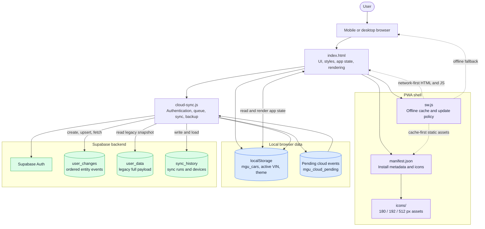

# Architecture Overview

## Component Roles

- **`index.html`**: Main PWA interface; contains the application markup, CSS, BMW vehicle and workshop features, UI state, and rendering logic.
- **`manifest.json`**: Defines installable-app metadata, orientation, theme, language, and icon assets.
- **`sw.js`**: Provides offline caching, network-first behavior for HTML and JavaScript, cache-first behavior for other resources, and old-cache cleanup.
- **`cloud-sync.js`**: Imports Supabase, manages authentication, local event detection, pending-change ownership, synchronization, JSON backup/restore, devices, and sync history.
- **Browser `localStorage`**: Stores vehicle profiles, the active VIN, theme, pending events, device identity, restore markers, and the last successful sync time.
- **Supabase**: Supplies auth and cloud persistence through `user_changes`, legacy `user_data`, and `sync_history` tables.

## Runtime Flow

1. The browser loads `index.html` and registers the PWA resources.
2. `index.html` reads and updates vehicle data in `localStorage`.
3. `cloud-sync.js` observes local changes and queues allowed entity events while online or offline.
4. On authentication or network recovery, pending events are uploaded to Supabase and merged with cloud event history.
5. The merged state is sanitized and written back to `localStorage`, then the UI is rendered again.
6. The service worker provides offline access and refreshes HTML/JavaScript from the network when available.
